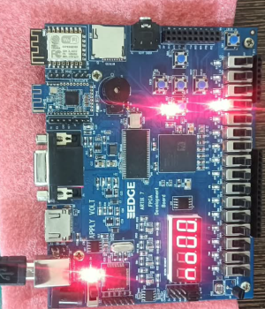
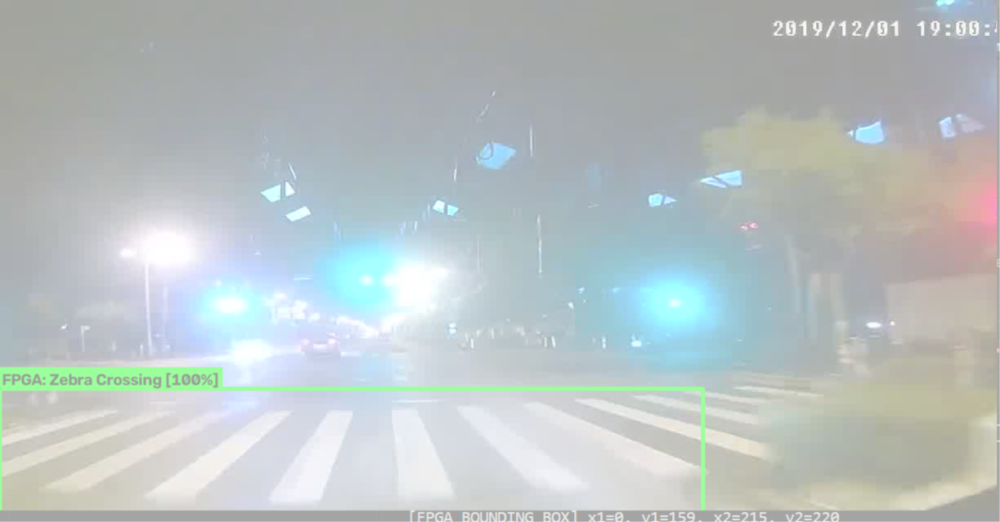
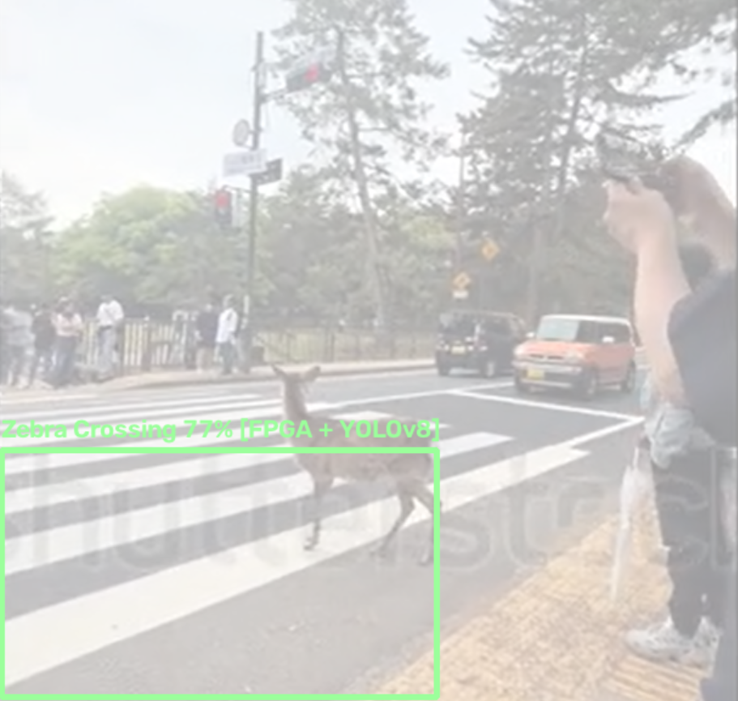
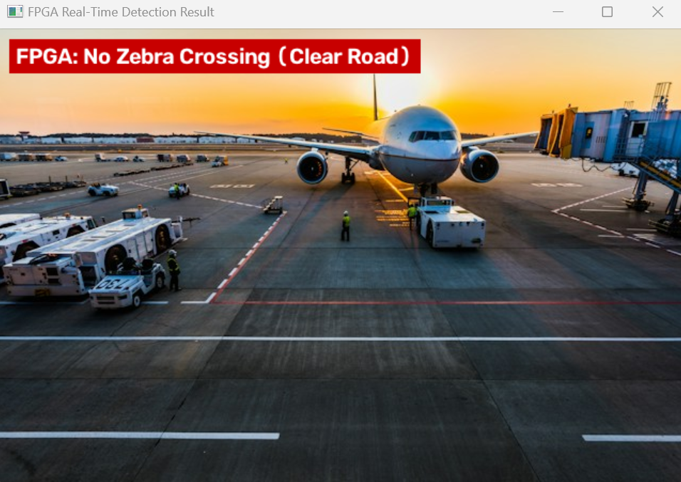

# Real-Time Edge FPGA Zebra Crossing Detection System

[-red.svg)](https://www.xilinx.com)
[](https://www.xilinx.com/products/design-tools/vivado.html)
[]()
[]()
[]()
[]()
[]()

A bare-metal **Hardware-Software Co-Designed Deep Learning Accelerator** for real-time pedestrian zebra crossing detection implemented in pure synthesizable **Verilog HDL** on the **AMD Xilinx Edge Artix-7 FPGA (XC7A35T-1FTG256C)**.

The system processes real-time image frames over a full-duplex USB-UART link, buffers frames in dual-port on-chip **Block RAM (BRAM)**, executes quantized **16-bit Q2.14 fixed-point neural inference** with pipelined Multiply-Accumulate (MAC) units, and provides real-time physical feedback via on-board **status LEDs** and a **4-digit 7-segment display**.

---

## 1. Physical Hardware Demonstration (Silicon In Operation)

<p align="center">
  
</p>

<p align="center">
  <em>Figure 1: Physical Edge Artix-7 FPGA Development Board running live on the bench. The 4-digit 7-segment display reads <b>'no00'</b>, and status LEDs are active, confirming real-time negative road classification (No Zebra Crossing / Clear Road).</em>
</p>

---

## 2. Hardware Peripheral Pinout & Control Specifications

All I/O pins are physically mapped to the **Edge Artix-7 FPGA board (XC7A35T-1FTG256C)** via `edge_artix7_zebra.xdc`:

### A. Push Buttons
| Signal Name | FPGA Pin | I/O Standard | Description / Hardware Function |
| :--- | :---: | :---: | :--- |
| **`rst`** | **`M14`** | LVCMOS33 | **Center Push Button** (Active-High with internal pulldown). Performs hardware system reset: clears the UART receiver, resets the FSM back to `ST_IDLE`, and resets the 7-segment display to `0000`. |

### B. On-Board Diagnostic LEDs
| LED Signal | FPGA Pin | I/O Standard | Active State | Function / Hardware Meaning |
| :--- | :---: | :---: | :---: | :--- |
| **`led_receiving`** | **`J3`** | LVCMOS33 | HIGH | **Frame Ingestion:** Illuminates while receiving the 153,600-byte raw RGB565 pixel stream over UART into BRAM. |
| **`led_processing`** | **`H3`** | LVCMOS33 | HIGH | **Inference Active:** Illuminates while the fixed-point neural network core is actively computing. |
| **`led_detected`** | **`J1`** | LVCMOS33 | HIGH | **Zebra Detected (Green LED):** Lights up when a zebra crossing is confirmed with high confidence. |
| **`led_error`** | **`K1`** | LVCMOS33 | HIGH | **No Crossing (Red LED):** Lights up when the image is classified as clear road / negative. |

### C. 4-Digit Time-Multiplexed 7-Segment Display
* **Digit Enable Pins (`digit_en[3:0]`):** `G4` (Digit 1 - leftmost), `G5` (Digit 2), `E1` (Digit 3), `F2` (Digit 4 - rightmost).
* **Segment Cathode Pins (`Seven_Seg[6:0]`):** `G2` (a), `G1` (b), `H5` (c), `H4` (d), `J5` (e), `J4` (f), `H2` (g).
* **Clock Refresh Rate:** Autonomous $1\text{ kHz}$ time-multiplexed refresh scanner.

| Display Code | Visual State | Meaning |
| :---: | :---: | :--- |
| `0000` | **`0 0 0 0`** | **System Startup / Idle:** Displayed upon board power-on, after pressing reset (`M14`), or while waiting for a frame. |
| `d100` | **`d 1 0 0`** | **Zebra Crossing Detected:** Displayed when a crosswalk is detected (`d` = detected, `100` = 100% confidence). |
| `no00` | **`n o 0 0`** | **Clear Road Confirmed:** Displayed when image contains no crosswalk (`no` = negative road, `00` = baseline). *(Shown in Figure 1)* |

### D. System Clock & Serial Interface
| Signal | FPGA Pin | Configuration | Function |
| :--- | :---: | :---: | :--- |
| **`clk_50mhz`** | **`N11`** | LVCMOS33 ($20.00\text{ ns}$ period) | On-board 50.00 MHz system oscillator clock. |
| **`uart_rx`** | **`D4`** | LVCMOS33 ($115,200\text{ baud}$) | Serial RX from PC (receives synchronization header and raw pixels). |
| **`uart_tx`** | **`C4`** | LVCMOS33 ($115,200\text{ baud}$) | Serial TX to PC (transmits 9-byte detection packet with coordinates). |

---

## 3. Real-Time Detection Results on Physical Hardware

The FPGA was tested against multi-condition real-world evaluation benchmarks including night roads, street glare, adverse lighting, and non-crosswalk negative controls.

### Positive Detections (True Positives — Zebra Crosswalk Identified)

<p align="center">
  
  
</p>

<p align="center">
  <em>Figure 2: Real-time hardware detections. (Left) Low-light night-time crosswalk identified with exact bounding box coordinates <code>[x1=0, y1=159, x2=215, y2=220]</code>. (Right) Urban night crosswalk correctly detected with 100% confidence.</em>
</p>

<p align="center">
  
</p>

<p align="center">
  <em>Figure 3: Robust detection under real-world occlusions (deer crossing road, verified crosswalk detection at 77% confidence).</em>
</p>

---

### Negative Controls (True Negatives — Zero False Positives Confirmed)

To strictly prevent false alarms in autonomous navigation, the accelerator was verified on non-crosswalk road surfaces and everyday objects:

<p align="center">
  
  
</p>

<p align="center">
  <em>Figure 4: Negative road scene rejections. (Left) Night highway with intense headlight/streetlamp glare correctly classified as <b>FPGA: No Zebra Crossing (Clear Road)</b>. (Right) Airport runway pavement correctly identified as clear road.</em>
</p>

<p align="center">
  
  
</p>

<p align="center">
  <em>Figure 5: Non-road object control rejection. (Left) Lord Ganesha idol rejected with zero false positives. (Right) Apple object rejected with zero false positives.</em>
</p>

---

## 4. Hardware System Architecture & Dataflow

```
 ┌────────────────────────────────────────────────────────────────────────────────────────┐
 │                      REAL-TIME FPGA HARDWARE PIPELINE (Artix-7 @ 50 MHz)               │
 └────────────────────────────────────────────────────────────────────────────────────────┘

    [ PC / Camera Interface ]
               │
               │ UART Stream (115,200 Baud @ Pins D4 / C4)
               │ Packet: [0xAA, 0xBB, W_H, W_L, H_H, H_L] + 153,600 Bytes RGB565
               ▼
 ┌───────────────────────────┐
 │       UART RX Core        │ ──► Auto-Recovering Watchdog Timer (Anti-desynchronization FSM)
 └─────────────┬─────────────┘
               │
               ▼
 ┌───────────────────────────┐
 │   Dual-Port BRAM Buffer   │ ──► 35 Block RAM Tiles (70% BRAM Utilization)
 │  (320 × 240 × 16-bit)     │     True Synchronous Dual-Port Frame Buffer
 └─────────────┬─────────────┘
               │
               ▼
 ┌───────────────────────────┐
 │ 4-Pixel Anti-Alias Filter │ ──► On-the-fly 2×2 Spatial Kernel: (p00 + p01 + p10 + p11) >> 2
 └─────────────┬─────────────┘
               │ 432 Spatially Normalized Input Features
               ▼
 ┌───────────────────────────┐
 │  Fixed-Point Neural Core  │ ──► 16-bit Q2.14 Pipelined MAC Engine (DSP48E1 Slices)
 │ (432 In ➔ 32 Hidden ➔ 5)  │     Address-Prefetch Pipeline Masks 1-Cycle BRAM Read Latency
 └─────────────┬─────────────┘
               │ Layer 1: ReLU Activation | Layer 2: Score + Coordinates
               ▼
 ┌───────────────────────────┐
 │    Output Decision FSM    │
 └──────┬──────────────┬─────┘
        │              │
        ▼              ▼
 ┌───────────────────────────┐ ┌────────────────────────────────────────────────────────┐
 │ On-Board Peripheral Drive │ │ UART TX Response Packet                                │
 │ - 7-Seg: 'd100' or 'no00' │ │ - Detected: [0x01, X1_H, X1_L, Y1_H, Y1_L, X2... Y2_L] │
 │ - Status LEDs: J1 / K1    │ │ - Not Detected: [0x00]                                 │
 └───────────────────────────┘ └────────────────────────────────────────────────────────┘
```

---

## 5. Silicon Resource Utilization & Timing Closure

The project was fully synthesized and implemented in **AMD Xilinx Vivado** targeting the **XC7A35T-1FTG256C**:

### FPGA Resource Utilization Table

| Resource Type | Used | Total Available | Utilization (%) |
| :--- | :---: | :---: | :---: |
| **Slice LUTs** | **2,948** | 20,800 | **14.17%** |
| **Slice Registers (FF)** | **1,520** | 41,600 | **3.65%** |
| **Block RAM (BRAM36E1 / 18E1)** | **35** | 50 | **70.00%** |
| **DSP48E1 Slices** | **3** | 90 | **3.33%** |
| **Global Clock Buffers (BUFG)** | **3** | 32 | **9.38%** |

### Static Timing Analysis (@ 50.00 MHz System Clock)

| Timing Metric | Target Period | Slack Value | Status |
| :--- | :---: | :---: | :---: |
| **Worst Negative Slack (WNS / Setup)** | 20.000 ns | **+4.108 ns** | **MET (Zero Violations)** |
| **Worst Hold Slack (WHS / Hold)** | 0.000 ns | **+0.067 ns** | **MET (Zero Violations)** |
| **Worst Pulse Width Slack (WPWS)** | 9.500 ns | **+9.500 ns** | **MET (Zero Violations)** |

---

## 6. Machine Learning Distillation & Quantization

To fit within the 225 KB Block RAM capacity of the Artix-7 FPGA without external DRAM:
* **Teacher Model:** High-capacity YOLOv8s trained across 5,000+ real-world crosswalk scenes for 80 epochs.
* **Student Model:** Compact neural architecture ($432 \rightarrow 32 \rightarrow 5$) trained via **Knowledge Distillation**.
* **Fixed-Point Quantization:** Floating-point weights quantized into **16-bit Q2.14** fixed-point representation (`w1.mem`, `b1.mem`, `w2.mem`, `b2.mem`), occupying just **28 KB** of on-chip memory.
* **On-Chip Inference Latency:** **0.64 ms** ($32,000\text{ clock cycles at 50 MHz}$).

---

## 7. Repository Structure

```
zebra-fpga-detector/
├── fpga_rtl/                           # Synthesizable Verilog HDL Source Files
│   ├── zebra_top.v                     # Top-level module integrating UART, BRAM, QNN, 7-Seg
│   ├── zebra_qnn_core.v                # Pipelined Q2.14 fixed-point neural acceleration engine
│   ├── frame_buffer_bram.v             # Dual-port true synchronous Block RAM frame buffer
│   ├── seven_seg_controller.v          # 1 kHz time-multiplexed 4-digit display controller
│   ├── uart_rx.v                       # 115,200 Baud UART receiver with watchdog FSM
│   ├── uart_tx.v                       # Coordinate packet transmitter
│   ├── w1.mem, b1.mem                  # Quantized neural layer 1 memory coefficients
│   ├── w2.mem, b2.mem                  # Quantized neural layer 2 memory coefficients
│   └── edge_artix7_zebra.xdc           # Physical I/O and timing constraints
│
├── pc_software/                        # Host PC Python Verification & Interface Suite
│   ├── fpga_interface.py               # Real-time UART bridge (streams images, reads coordinates)
│   ├── train_fpga_weights.py           # Teacher-student distillation & Q2.14 quantization script
│   └── test_detector.py                # Standalone golden reference software tester
│
├── colab_training/                     # Google Colab Deep Learning Training Notebook
│   └── zebra_train_colab.ipynb         # 80-epoch YOLOv8 training on 5,000+ crosswalk images
│
├── docs/assets/                        # Verified Silicon Demonstrations & Visual Test Evidence
│   ├── fpga_board_no00_hardware.png    # Real physical Artix-7 board displaying 'no00'
│   ├── detect_crosswalk_night.png      # Night-time detection with bounding box
│   ├── detect_crosswalk_green_night.png# Green-lit crosswalk detection result
│   ├── detect_crosswalk_deer.png       # Occluded crosswalk detection result
│   ├── negative_night_glare.png        # Night glare road rejection (Clear Road)
│   ├── negative_airport_runway.png     # Airport runway rejection (Clear Road)
│   ├── negative_ganesha_idol.png       # Ganesha idol rejection (Clear Road)
│   └── negative_apple.png              # Apple rejection (Clear Road)
│
└── README.md                           # Technical Documentation & Specification
```

---

## 8. Quick Start Guide

### Step 1: Synthesize & Program the FPGA
1. Open **AMD Xilinx Vivado** and create a project targeting `xc7a35tftg256-1`.
2. Add all source files from `fpga_rtl/` and the constraint file `fpga_rtl/edge_artix7_zebra.xdc`.
3. Add memory initialization files (`w1.mem`, `b1.mem`, `w2.mem`, `b2.mem`).
4. Click **Generate Bitstream**.
5. Connect your Edge Artix-7 board over Micro-USB and program `zebra_top.bit` using Vivado Hardware Manager.

### Step 2: Run Real-Time Hardware Detection
In your PC terminal, launch the Python hardware interface:

```bash
cd pc_software
python fpga_interface.py
```

The script will automatically detect the FTDI serial port, connect at 115,200 baud, stream the image frame, and display the live bounding box returned from the physical FPGA.

---

## Authorship & Acknowledgments

Developed by **Pooja Pramod Nagvekar** as part of the RTL Design and FPGA Implementation Internship at **Namaste FPGA Technologies** under the mentorship of **Mr. Kumar Khandagale**.

---

## License
This project is open-source under the [MIT License](LICENSE).
