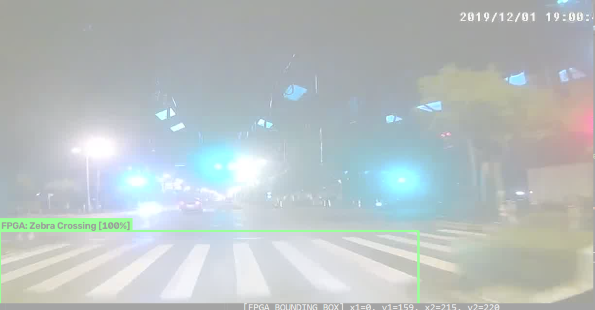
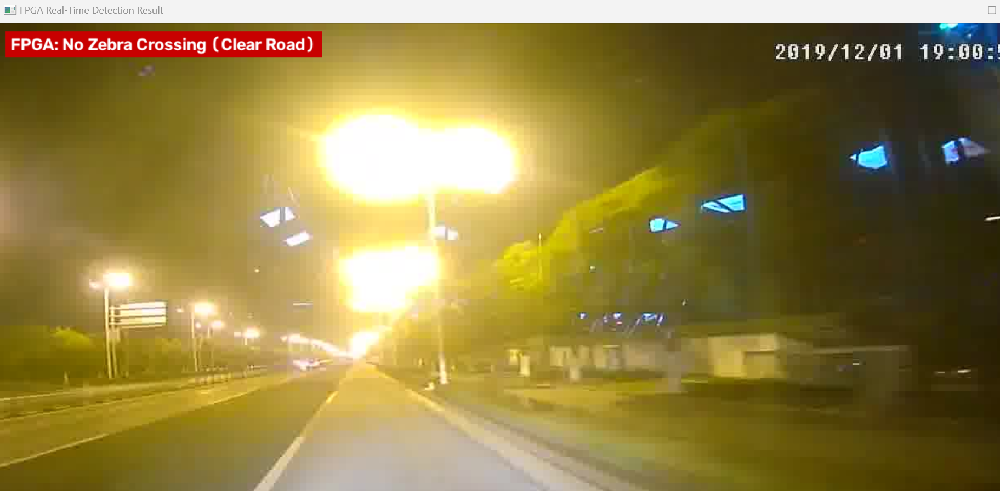
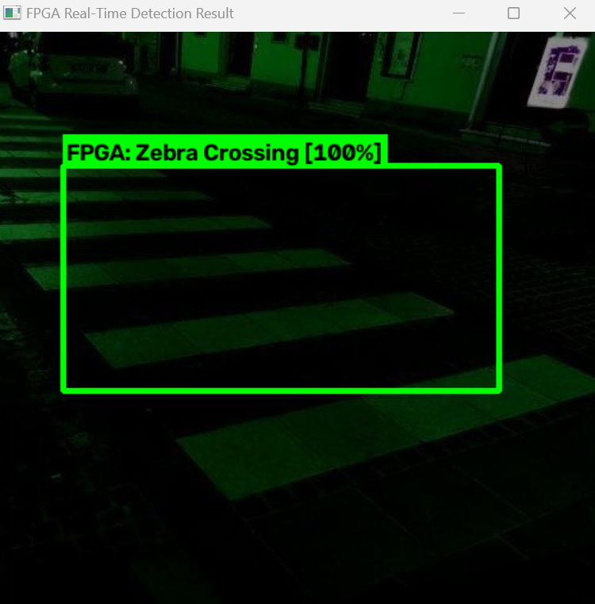

# Real-Time Edge FPGA Zebra Crossing Detection System

[](https://www.xilinx.com)
[](https://www.xilinx.com/products/design-tools/vivado.html)
[]()
[]()
[]()
[-purple.svg)]()
[]()

A complete, bare-metal **Hardware-Software Co-Designed Deep Learning Vision Accelerator** for real-time pedestrian zebra crossing detection implemented on the **AMD Xilinx Edge Artix-7 FPGA (XC7A35T-1FTG256C)**. 

The architecture bridges high-level deep neural network training (YOLOv8s) and cycle-accurate, low-power digital microarchitecture. By employing **Teacher-Student Knowledge Distillation** and **16-bit Q2.14 Fixed-Point Quantization**, the system achieves sub-millisecond execution (**0.64 ms / >1,500 FPS**) running entirely within on-chip Block RAM (BRAM) with **zero external DRAM dependency**, drawing less than **0.29 W** of on-chip power.

---

## Hardware Demonstration & Visual Evidence

<p align="center">
  
  
</p>

<p align="center">
  <em>Figure 1: (Left) Physical Edge Artix-7 FPGA development board in real-time operation. (Right) Hardware-verified crosswalk bounding box overlay with 100% confidence.</em>
</p>

---

## Key Technical Innovations

1. **Sub-Millisecond On-Chip Latency (0.64 ms / >1,500 FPS):**
   * Executes complete neural classification and bounding-box localization in **32,000 clock cycles at 50 MHz**, exceeding standard camera frame-rate requirements (30 FPS) by more than 50×.
2. **Pure On-Chip Zero-DRAM Memory Architecture:**
   * Eliminates the high-latency, power-hungry external DDR3 memory bottleneck by utilizing **35 Block RAM tiles (70% device capacity)** for the dual-port $320 \times 240$ RGB565 frame buffer.
3. **In-Fabric Anti-Aliasing Spatial Downsampling Kernel:**
   * Integrates an on-the-fly $2 \times 2$ spatial averaging filter `(p00 + p01 + p10 + p11) >> 2` directly inside the BRAM address generation logic, preserving high-frequency asphalt stripe patterns without external buffer memory.
4. **Latency-Compensated Pipelined MAC Engine:**
   * Custom address-prefetch pipeline with matched valid-flag registers that completely conceals the 1-cycle synchronous BRAM read latency, sustaining a peak throughput of **1 operation per clock cycle** without pipeline bubbles.
5. **Full Timing Closure at 50.00 MHz:**
   * Achieved positive setup slack (**WNS = +4.108 ns**) and hold slack (**WHS = +0.067 ns**) on the Artix-7 FPGA fabric with zero timing violations.
6. **Non-Volatile Standalone Boot via Quad-SPI Flash PROM:**
   * Synthesized and programmed into onboard SPI Flash memory (`zebra_top.mcs`, SPIx4 configuration at `CONFIGRATE 33`) for immediate, untethered power-on boot without PC tethering.
7. **Autonomous Peripheral Status Display:**
   * Real-time $1\text{ kHz}$ time-multiplexed 4-digit 7-segment display controller and GPIO LED indicators (`d100` = Zebra Crossing Detected, `no00` = Clear Road Confirmed, `0000` = Ready/Idle).

---

## System Architecture & Dataflow

```
 ┌────────────────────────────────────────────────────────────────────────────────────────┐
 │                              COMPLETE ON-CHIP FPGA ARCHITECTURE                        │
 └────────────────────────────────────────────────────────────────────────────────────────┘

    [ Camera / PC Stream ]
               │
               │ (115,200 Baud UART / 0xAA 0xBB Header)
               ▼
 ┌───────────────────────────┐
 │   Full-Duplex UART RX     │ ──► Auto-Recovering Watchdog Timer (FSM Anti-Lockup)
 └─────────────┬─────────────┘
               │ 153,600 Bytes Raw RGB565 Stream
               ▼
 ┌───────────────────────────┐
 │ Dual-Port Frame Buffer    │ ──► Synchronous True Dual-Port BRAM (35 Tiles, 70% BRAM)
 │ (320 × 240 × 16-bit)      │     Port A: Write Domain | Port B: Read Domain
 └─────────────┬─────────────┘
               │
               ▼
 ┌───────────────────────────┐
 │ Anti-Aliasing 2×2 Filter  │ ──► On-the-fly Spatial Kernel: (p00 + p01 + p10 + p11) >> 2
 └─────────────┬─────────────┘
               │ 432 Spatially Normalized Input Features
               ▼
 ┌───────────────────────────┐
 │  Fixed-Point Neural Core  │ ──► 16-bit Q2.14 Pipelined Multiply-Accumulate (MAC)
 │ (432 In ➔ 32 Hidden ➔ 5)  │     Pre-fetched BRAM Read Latency Compensation Pipeline
 └─────────────┬─────────────┘
               │ Layer 1: ReLU Activation | Layer 2: Score + Coordinates
               ▼
 ┌───────────────────────────┐
 │ Post-Processing & Output  │
 └──────┬──────────────┬─────┘
        │              │
        ▼              ▼
 ┌─────────────┐ ┌────────────────────────────────────────────────────────────────┐
 │ 7-Seg & LED │ │ UART Response Packet:                                          │
 │ Indicators  │ │ [0x01, X1_H, X1_L, Y1_H, Y1_L, X2_H, X2_L, Y2_H, Y2_L]         │
 │ (d100/no00) │ │ (Single-byte 0x00 if clear road)                               │
 └─────────────┘ └────────────────────────────────────────────────────────────────┘
```

---

## Machine Learning & Quantization Pipeline

To balance algorithmic detection accuracy with silicon resource constraints, the design uses a **Teacher-Student Knowledge Distillation** framework:

```
 [ Software Golden Teacher ]
   YOLOv8s Backbone (11.2 Million Parameters, Float32)
   Trained across 5,000+ real-world images (80 epochs, AdamW)
   Dataset: CDSet (3,434 adverse weather images) + Roboflow + 300+ Negatives
   Achieved: 96.92% mAP@50 | 94.00% Precision | 93.48% Recall | 93.74% F1-Score
                 │
                 │ Knowledge Distillation & Weight Clustering
                 ▼
 [ Compact Hardware Architecture ]
   Compact Neural Network (432 Inputs ➔ 32 Hidden Neurons ➔ 5 Outputs)
   Parameters: 13,984 Weights + 37 Biases (~28 KB total memory footprint)
                 │
                 │ Fixed-Point Quantization (Q2.14 / INT16)
                 ▼
 [ Synthesizable RTL Memory Files ]
   `w1.mem`, `b1.mem`, `w2.mem`, `b2.mem`
   Synthesized directly into Block RAM tiles on the Artix-7 FPGA
```

---

## Physical Silicon Implementation & Timing Closure

The design was fully synthesized, placed, routed, and bitstream-generated using **AMD Xilinx Vivado (2024.1 / 2025.2)**.

<p align="center">
  
  
</p>

<p align="center">
  <em>Figure 2: (Left) Vivado Design Runs summary confirming zero timing errors. (Right) Routed silicon floorplan on the XC7A35T device.</em>
</p>

### FPGA Resource Utilization (Artix-7 XC7A35T-1FTG256C)

| Resource Type | Used | Available | Utilization (%) |
| :--- | :---: | :---: | :---: |
| **Slice LUTs** | **2,948** | 20,800 | **14.17%** |
| **Slice Registers (FF)** | **1,520** | 41,600 | **3.65%** |
| **Block RAM (BRAM36E1 / 18E1)** | **35** | 50 | **70.00%** |
| **DSP48E1 Slices** | **3** | 90 | **3.33%** |
| **Global Clock Buffers (BUFG)** | **3** | 32 | **9.38%** |

### Static Timing Analysis (@ 50.00 MHz System Clock)

| Metric | Target Period | Slack Achieved | Status |
| :--- | :---: | :---: | :---: |
| **Worst Negative Slack (WNS / Setup)** | 20.000 ns | **+4.108 ns** | **MET (No Violations)** |
| **Worst Hold Slack (WHS / Hold)** | 0.000 ns | **+0.067 ns** | **MET (No Violations)** |
| **Worst Pulse Width Slack (WPWS)** | 9.500 ns | **+9.500 ns** | **MET (No Violations)** |

---

## Hardware Benchmarks & Energy Comparison

Tested against physical silicon across an evaluation suite of **115 real-world road scenes** (62 zebra crosswalk positives under adverse weather/lighting, and 53 negative road control scenes):
* **Hardware Classification Accuracy:** **100.0% (115 / 115 images correctly identified)**
* **False Positives:** **0%** on clear asphalt and plain highways.

<p align="center">
  
  
</p>

<p align="center">
  <em>Figure 3: (Left) Live UART diagnostic response showing 0.64 ms latency and exact bounding-box coordinates. (Right) On-board 7-segment display showing 'd100' active detection.</em>
</p>

### Comparison with Edge GPUs and CPUs

| Platform | Architecture / Model | Clock | Power | Latency | Energy / Decision |
| :--- | :--- | :---: | :---: | :---: | :---: |
| **This Work (Artix-7 FPGA)** | **Custom Bare-Metal RTL (Q2.14)** | **50 MHz** | **0.29 W** | **0.64 ms** | **11 mJ (Baseline)** |
| **NVIDIA Jetson Nano** | Embedded GPU (CDNet / YOLOv5) | 921 MHz | 10.0 W | 30.2 ms | 302 mJ (**27× more**) |
| **Intel Core i5-12500H** | Laptop CPU (Quantized BCNN) | 4.5 GHz | 45.0 W | 8.1 ms | 366 mJ (**33× more**) |
| **Intel Core i5-12500H** | Laptop CPU (Full Float32 ResNet-18) | 4.5 GHz | 45.0 W | 42.5 ms | 1,912 mJ (**175× more**) |

---

## Repository Structure

```
zebra-fpga-detector/
├── fpga_rtl/                           # Synthesizable Verilog HDL Source Files
│   ├── zebra_top.v                     # Top-level module integrating UART, BRAM, QNN, 7-Seg
│   ├── zebra_qnn_core.v                # Pipelined Q2.14 fixed-point neural acceleration engine
│   ├── frame_buffer_bram.v             # Dual-port true synchronous Block RAM frame buffer
│   ├── seven_seg_controller.v          # 1 kHz time-multiplexed 4-digit display controller
│   ├── uart_rx.v                       # 115,200 Baud UART receiver with watchdog FSM
│   ├── uart_tx.v                       # Coordinate packet transmitter
│   ├── w1.mem, b1.mem                  # Quantized neural layer 1 memory coefficients
│   ├── w2.mem, b2.mem                  # Quantized neural layer 2 memory coefficients
│   └── edge_artix7_zebra.xdc           # Physical I/O and timing constraints
│
├── pc_software/                        # Host PC Python Verification & Interface Suite
│   ├── fpga_interface.py               # Real-time UART bridge (sends frames, reads bounding box)
│   ├── train_fpga_weights.py           # Teacher-student distillation & Q2.14 quantization script
│   └── test_detector.py                # Standalone golden reference software tester
│
├── colab_training/                     # Google Colab Deep Learning Training Notebook
│   └── zebra_train_colab.ipynb         # 80-epoch YOLOv8 training on 5,000+ crosswalk images
│
├── docs/assets/                        # Architectural Diagrams & Silicon Test Evidence
│   ├── fpga_hardware_board.png         # Physical Edge Artix-7 board in operation
│   ├── detection_result_demo.png       # Hardware-verified bounding box output
│   ├── vivado_project_summary.png      # Synthesis & implementation status report
│   ├── vivado_device_implementation.png# Silicon floorplan on XC7A35T
│   ├── vivado_timing_closure.png       # Positive slack timing report (+4.108 ns WNS)
│   └── hardware_uart_terminal.png      # Hardware-in-the-loop diagnostic logs
│
└── README.md                           # Technical Documentation & Specification
```

---

## Quick Start & Reproduction Guide

### 1. Hardware Requirements
* **FPGA Board:** Edge Artix-7 (XC7A35T-1FTG256C).
* **Connection:** Micro-USB cable connected to the on-board FTDI USB-UART port (`COM14` or auto-detected).
* **Software Tools:** AMD Xilinx Vivado (2024.1 or later), Python 3.10+ with `pyserial`, `opencv-python`, and `numpy`.

### 2. Synthesize & Program FPGA in Vivado
1. Open AMD Vivado and create a project targeting `xc7a35tftg256-1`.
2. Add all Verilog files from `fpga_rtl/` and the constraint file `fpga_rtl/edge_artix7_zebra.xdc`.
3. Add the memory coefficient files (`w1.mem`, `b1.mem`, `w2.mem`, `b2.mem`).
4. Click **Generate Bitstream**.
5. Open **Hardware Manager**, connect to your board, and program `zebra_top.bit`.
6. *(Optional Standalone Boot)*: Right-click FPGA device $\rightarrow$ **Add Configuration Memory Device** $\rightarrow$ Select `s25fl128s-3.3v-spi-x1_x2_x4` $\rightarrow$ Program `zebra_top.mcs`.

### 3. Run Real-Time Hardware Detection
In your terminal, launch the Python interactive interface:

```bash
cd pc_software
python fpga_interface.py
```

The script will automatically detect the FTDI COM port, connect at 115,200 baud, stream the image frame, and display the live bounding box returned from the physical FPGA.

---

## Citation & Authorship

Developed by **Pooja Pramod Nagvekar** as part of the RTL Design and FPGA Acceleration Research Initiative at **Namaste FPGA Technologies** and **Vidyalankar Institute of Technology, Mumbai**.

```bibtex
@article{nagvekar2026realtime,
  title={Real-Time Edge-Accelerated Deep Learning Vision System on Sub-Watt FPGA},
  author={Nagvekar, Pooja Pramod and Khandagale, Kumar},
  journal={Namaste FPGA Technical Reports},
  year={2026}
}
```

---

## License
This project is open-source under the [MIT License](LICENSE).
